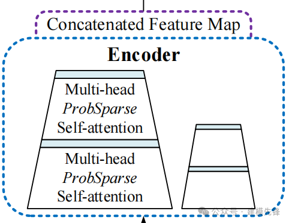
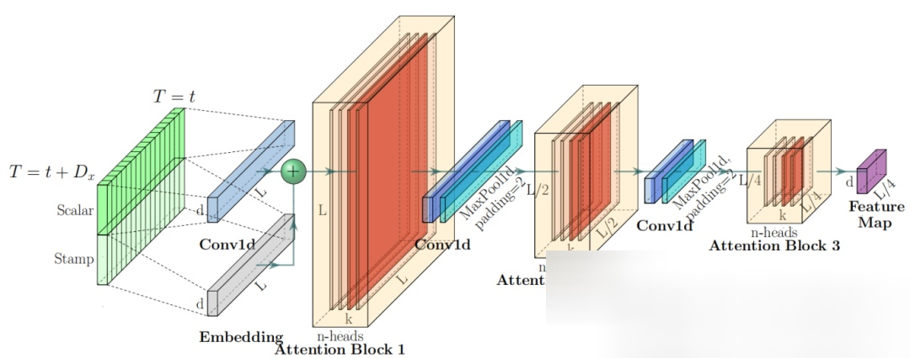
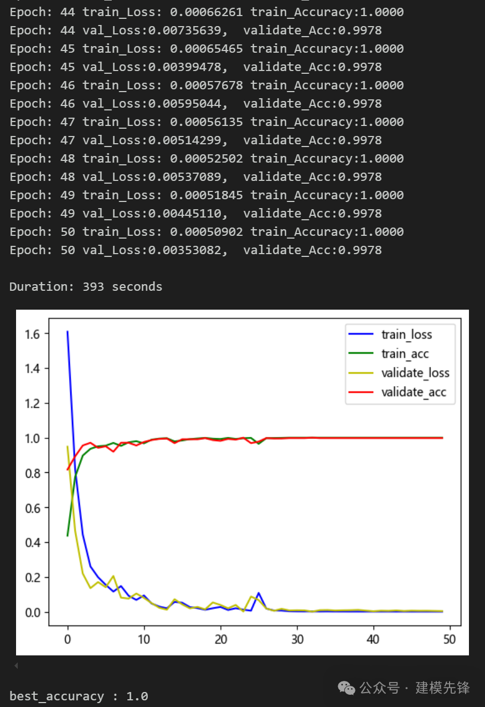

# Failure Diagnosis - directly write! SSA+Informer-SENet Failure Diagnosis Model

Preface  
This issue introduces an Informer model optimized with SENet, enhanced by a Phoebe optimization algorithm for search model parameters, achieving significant results in fault diagnosis tasks!  
●Dataset: CWRU West China University Bearing Dataset (also applicable to classification tasks such as power quality disturbance signals, electroencephalogram signals, and one-dimensional time series)  
●Environmental Framework: Python 3.9, PyTorch 1.8 or higher versions are compatible  
●Accuracy: 100% accuracy on both training and testing sets  
●Usage Objectives: Model paper requirements, graduation design requirements  
●Code Guarantee: Code comments are detailed, ready to run without modification.  
Model Performance Overview:  
Model Evaluation:  
Fault Classification Confusion Matrix:  
Trained T-SNE feature visualization:  
Note: We also provide accompanying model explanations (facilitating network structure learning) and video tutorials! For those who need a graduation project or a small thesis paper, this is essential. The modules are rich, innovative, highly performant, and the innovation model is ready to use upon purchase!
1. Innovation Points of the Model Introduction  
1.1 Time Series Features Capturing and Modeling  
Using the encoder layer of Informer to capture the temporal dependencies of long fault signals  
Long-term sequence processing: Traditional RNN and LSTM methods face issues such as low computational efficiency and gradient vanishing when handling long sequences. Informer improves the transformer architecture using ProbSparse Self-Attention mechanism, effectively enhancing computational efficiency, especially for long-term sequence data.  
Global feature extraction: Through multi-head attention mechanisms, Informer can capture global features and long-term dependencies in sequence data, ensuring comprehensive modeling of the temporal features of fault signals.  
1.2 Probability - Sparse Attention Mechanism (ProbSparse Self-attention)
Probabilistic sparse self-attention is a form of sparse self-attention mechanism introduced in the Informer model. Its core idea is to select the most important part of attention weights through probability methods, while ignoring those weights that have a smaller impact on the results. This method can significantly reduce computational complexity while maintaining high model performance.
Sparse Self-Attention: Unlike the standard Transformer's dense self-attention mechanism, Informer introduces ProbSparse Self-attention, which selects important Q-K pairs through a probability sampling mechanism to reduce computational complexity.
Efficiency Improvement: The sparse attention mechanism significantly reduces the computational complexity from O(L2⋅d) to O(L⋅log(L)⋅d), where L is the length of the sequence and d is the feature dimension per time step.
\t1.3 Multi-scale feature extraction - Information distillation
The architecture diagram of the Informer does not indicate the stacking of N encoders on the left side of the Encoder like the Transformer, but rather two trapezoids of different sizes.
\t  
The encoder's role is to distill self-attention, given that the ProbSparse auto-regressive mechanism often uses the mean of V for filling in attention sources, inherently leading to redundant attention sources. To address this, convolution and pooling are applied between adjacent Attention Blocks to downsample features. Therefore, when designing the encoder, the author employs distillation operations to continuously extract salient features, thereby obtaining feature maps worthy of attention.
\t  
Multi-scale time series feature extraction: Informer models features at different temporal granularities through multi-scale approaches, effectively capturing the multi-scale dependencies in time series.
Information distillation: An information distillation mechanism is introduced, which progressively reduces the temporal step size through hierarchical time convolutional pooling layers to extract features at various scales, achieving efficient modeling of long-term dependencies.
Convolutional dimensionality reduction: A 1D convolutional pooling layer is used in the encoder for dimensionality reduction, with a step size of 2, reducing the sequence length by half, further reducing computational complexity.
Information compression: Information is compressed through convolutional pooling layers, condensing long sequence information into shorter temporal steps, thereby more efficiently performing time series modeling.
Feature enhancement and fusion:
In the Informer's encoder layer, SENet is combined for feature enhancement.
Adaptive feature calibration: SENet adjusts the weights of each channel's features adaptively through the Squeeze-and-Excitation module, enhancing important features and suppressing irrelevant or redundant ones. This mechanism enhances the model's sensitivity to critical features of fault signals, improving the accuracy of fault diagnosis.
Channel interdependency modeling: SENet can capture the relationship between features from different channels, recalibrating the weight of feature channels to more effectively integrate multi-channel information, enhancing overall feature representation capability.
Sparrow optimization algorithm search parameters:
Through SSA, optimal parameter combinations can be efficiently found within a large parameter space, enhancing the diagnostic capabilities and generalization performance of the model.
Complexity of parameter space: The Informer-SENet model contains multiple hyperparameters such as learning rate, hidden layer dimensions, attention heads, and number of encoder layers, all of which significantly impact model performance.
Limitations of manual tuning: Manual tuning is time-consuming and difficult to ensure finding a global optimal parameter combination.
For more detailed content, refer to the instructional video!
2. Data Loading and Preprocessing
2.1 Importing Data
Refer to the previous article for preprocessing of fault classification 10, with the Case Western Reserve University bearing data set for fault classification 10:  
train_set, val_set, test_set are divided into training set, validation set, and test set in a ratio of 7:2:1 respectively, and finally save the data.  
The above figure shows the form of data reading and the preprocessing idea.
2.2 Data Preprocessing, Making the Dataset
3 Sparrow Optimization Algorithm
3.1 Introduction to Sparrow Optimization Algorithm
Sparrow Optimization Algorithm (SSA) is an optimization algorithm based on the characteristics of bird behavior in nature, simulating the optimization strategies of birds in foraging, migration, and social activities. This algorithm has shown good performance in solving various optimization problems.  
The basic idea of the Sparrow Optimization Algorithm is to continuously optimize the solutions in the search space by simulating the foraging behavior of birds. The process can be divided into three stages: foraging behavior, migration behavior, and social behavior.  
(1). Foraging Behavior: When searching for food, birds choose food sources that are closer and have higher fitness values. In the algorithm, each individual in the solution space is considered as a food source with a fitness evaluation value. Birds select individuals with higher fitness values to find better solutions.  
(2). Migration Behavior: When birds do not find a better solution around a food source after searching for a while, they will choose to leave the current food source and continue searching for other food sources. In the algorithm, the position information between individuals will change to simulate the migration behavior of birds.
(3). Social Behavior (Social Behavior): Sparrows obtain more information while foraging by communicating with other sparrows, thereby enhancing their foraging efficiency. In the algorithm, individuals exchange information to improve their solutions and update the optimal solution in the solution space.
\t3.2 Python-based Sparrow Optimization Algorithm Implementation
\t3.3 Sparrow Optimization Algorithm - Parametric Optimization Process
The Sparrow Optimization Algorithm is characterized by its simplicity, ease of implementation, global optimization capability, and adaptability, making it suitable for solving combinatorial optimization problems. We use the Sparrow Optimization Algorithm to optimize the hyperparameters of the Informer-SENet model.
By setting an appropriate population size and number of optimization iterations, we search for the optimal parameters within the given hyperparameter range.
\t
4. Pytorch-based SSA-Informer-SENet Novel Diagnosis Model
\t4.1 Definition of SSA-Informer-SENet Classification Network Model
\t4.2 Setting parameters and training the model
After 50 epochs, achieving a 100% accuracy rate, the SSA-Informer-SENet network classification effect is significant. The model can fully extract multi-scale features of bearing fault signals, has a fast convergence speed, and performs exceptionally well, with noticeable effects.
\t4.3 Model Evaluation
\tAccuracy, Precision, Recall, F1 Score
\tFault-class confusion matrix:
\tOther effectiveness demonstrations:
\t(1) Model training visualization
\t(2) Classification label visualization
\t(3) Original data t-SNE feature visualization
\t(4) T-SNE feature visualization after model training:
Click to download: Complete original data, Python code
Previously interesting content:
Python Bearing Fault Diagnosis | From Beginner to Publication
Python Bearing Fault Diagnosis (14) High-Innovation Fault Identification Model
| SCI 1 Zone High-Innovation Bearing Fault Diagnosis Model!
High-Innovation Bearing Fault Diagnosis Model Based on GADF+Swin-CNN-GAM
Attention Magic Mod | Superb Bearing Fault Diagnosis Model!
Python Bearing Fault Diagnosis (19) - Innovation in Diagnosis Model Based on Transformer-BiLSTM
Bearing Fault Diagnosis Model Based on K-NN + GCN
27 Bearing Fault Diagnosis Models | The Most Affordable Full Set Online
| Bearing Fault Diagnosis Model Based on KAN and Convolutional Kernels
Time-frequency chart update | Bearing fault diagnosis based on visual top conference + time-frequency chart
Fault Diagnosis | Code Explanation + Live Classes, currently in progress!
Fault Diagnosis | Innovative Model Update: Diagnostic Model Based on SSA-CNN-Transformer
Rapid Document | Parallel Fault Diagnosis Model Based on 2D-SWinTransformer+1D-CNN-SENet
| Kan, Kan convolution combined with attention mechanism!
Parallel Fault Diagnosis Model Based on 2D-SwinTransformer + BiGRU-GlobalAttention
Positional Decoding | Detailed Explanation of Positional Encoding in Transformer
Resource Sharing | Intelligent Fault Diagnosis and Prediction Based on Graph Neural Networks
Innovation Point | Fault Diagnosis Model Based on Fast Fourier Transform Convolution (FFC)
Code is open-source! | Domain Adversarial Networks for Fault Diagnosis under Variable Working Conditions
More than thirty open-source datasets | No more worries about data sets for fault diagnosis!
Fault Diagnosis | Essential for Master's and Doctoral Students to publish papers in their first and second years!
Superior! Top conference innovation integration! Parallel classification network based on 2D-SWinTransformer.
END  
2. Friends who enjoy the content can follow, give the article a "like", share on social media or discuss in groups.

## Images

<!-- PAYMENT_BLOCK -->

## Get this dataset

- Payment link (Stripe): [Buy now](https://buy.stripe.com/3cs8yP7sY87d0vu9AB)
- Payment QR code: 

<!-- /PAYMENT_BLOCK -->
